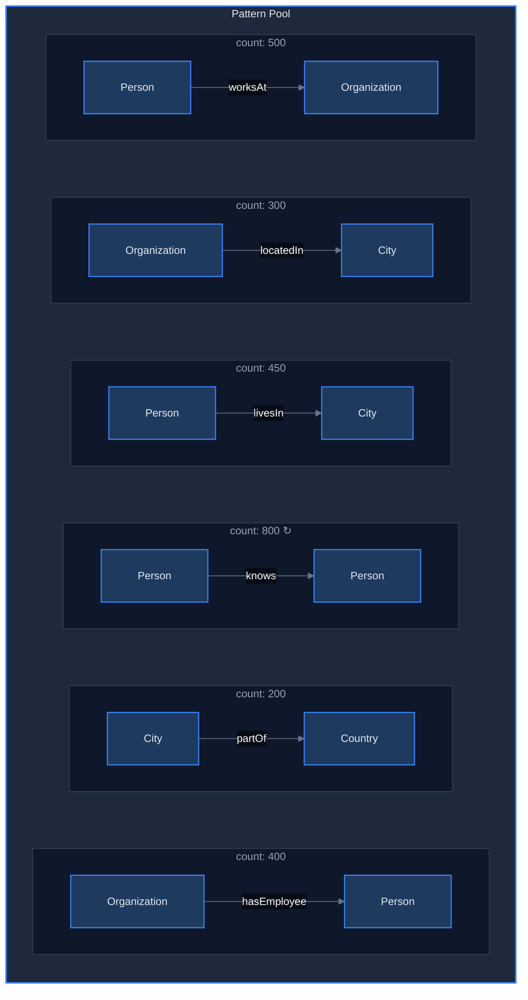
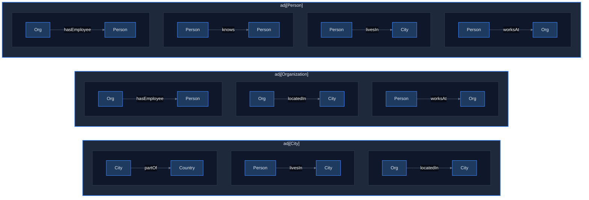
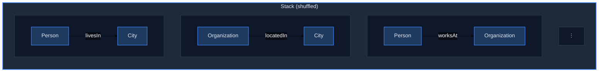
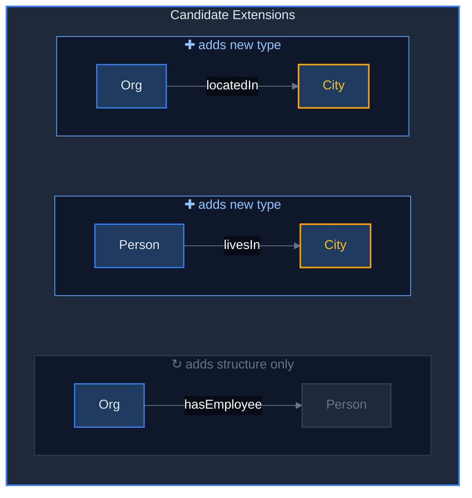
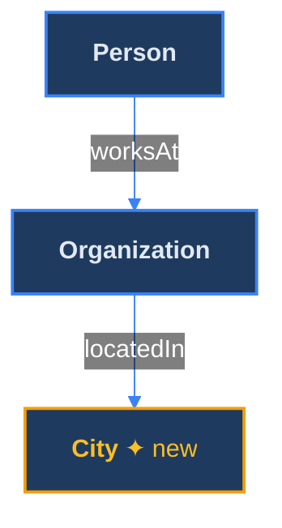
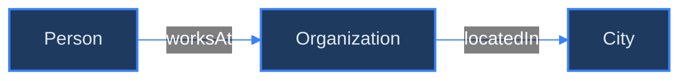
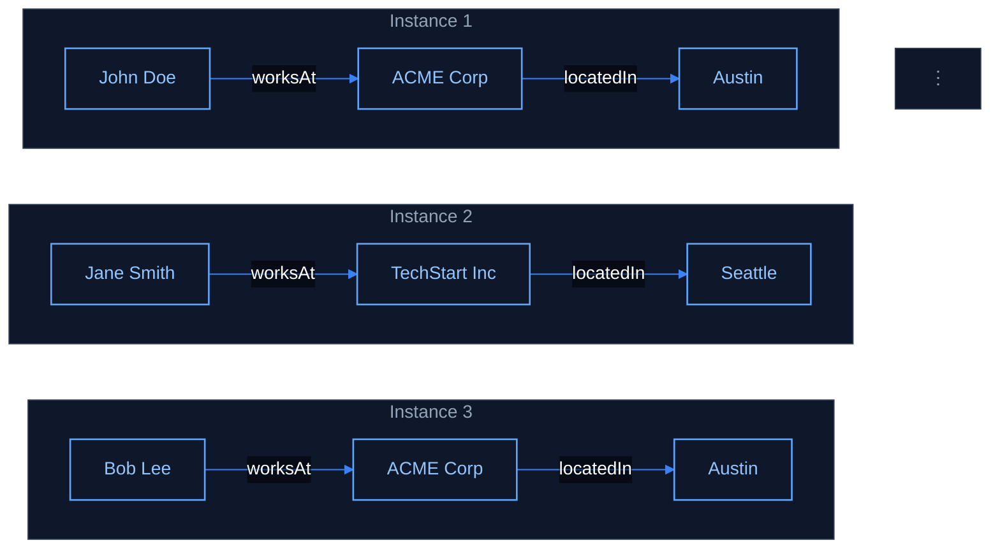
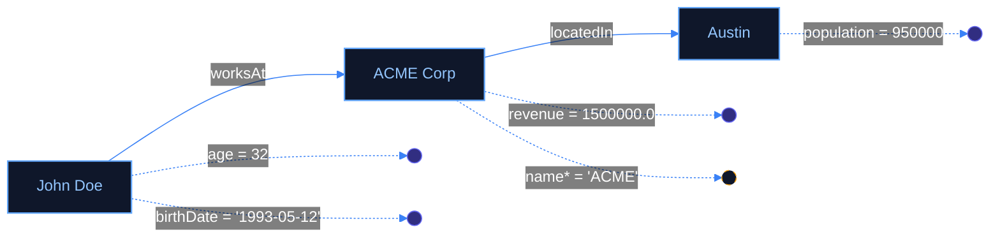
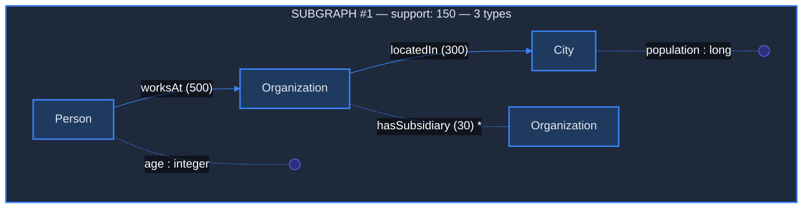

# QueryBloom Subgraph Mining

This module powers QueryBloom's frequent subgraph mining workflow for knowledge graphs.

## Live Frontend In Docker

The public frontend uses SvelteKit's Vite development server with HMR. This is an
intentional single-user development deployment, not a hardened production server.
Source edits under `webapp/src` appear automatically in an open browser. No
frontend build or backend restart is needed. Vite can reload the page for changes
that cannot be hot-updated, so avoid editing during critical browser operations.

Start the frontend alongside the existing backend:

```sh
docker compose up -d querybloom-frontend
```

It listens on `127.0.0.1:5174` and forwards API requests to
`querybloom-prod:8000`. The HTTPS proxy's `/querybloom/` location must preserve
the prefix and forward WebSockets:

```nginx
location /querybloom/ {
    proxy_pass http://127.0.0.1:5174;
    proxy_http_version 1.1;
    proxy_set_header Host $host;
    proxy_set_header X-Real-IP $remote_addr;
    proxy_set_header X-Forwarded-For $proxy_add_x_forwarded_for;
    proxy_set_header X-Forwarded-Proto $scheme;
    proxy_set_header Upgrade $http_upgrade;
    proxy_set_header Connection "upgrade";
    proxy_buffering off;
    proxy_read_timeout 86400s;
}
```

After dependency manifest changes, run
`docker compose restart querybloom-frontend` to reinstall dependencies. After
Compose configuration changes, run `docker compose up -d --no-deps querybloom-frontend`.
The frontend installs locked dependencies on startup and restarts automatically
with Docker. Backend reload behavior is unchanged. The static bundle served on
port 8002 remains available but is not used by the public frontend after the proxy
is switched to Vite.

## Overview

- **ABSTAT**: Extracts frequent (subject_type, predicate, object_type) patterns from a knowledge graph
- **SubgraphMiner**: Uses ABSTAT patterns to discover connected subgraphs with configurable size and support thresholds

---

## How QueryBloom Subgraph Mining Works

### 1. Starting Point: Frequent Patterns from ABSTAT

The miner starts with **frequent patterns** (subject_type, predicate, object_type) that appear at least `min_support` times. Think of these as "edges" in a type-level graph:



### 2. Building the Adjacency Index

For fast lookups, patterns are indexed by their types so that when we have a partial subgraph with type `T`, we can instantly find all patterns that touch `T`:



### 3. DFS Mining Process (Finding k=3 types)

#### Step 1: Initialize Stack with Base Patterns

Each single pattern becomes a candidate subgraph. The patterns are **shuffled** for random start order:



#### Step 2: Pop and Extend

Pop: `{Person, Organization}` with edge `Person --worksAt--> Organization`


Current subgraph has **2 types**, but we need **3**. Find extensions by looking at `adj[Person]` and `adj[Organization]`:



#### Step 3: Push Extended Candidates

One possible extension extends the subgraph to 3 types:



> **types = {Person, Organization, City} — k=3 REACHED ✓**

#### Step 4: Verify Support with SPARQL

Before accepting, the algorithm verifies the **combined pattern** has enough instances:

```sparql
SELECT (COUNT(*) as ?count) WHERE {
    ?v0 a <City> .
    ?v1 a <Organization> .
    ?v2 a <Person> .
    ?v2 <worksAt> ?v1 .
    ?v1 <locatedIn> ?v0 .
}
```

This counts **actual embeddings** in the KG—real entities matching this structure.

- If `count >= min_support` → edge is **required** ✓
- If `1 <= count < min_support` and optional slots remain → edge is marked **optional** (shown with `*`)
- If `count = 0` → candidate is **pruned**

#### Step 5: Sample Entity Instances

Once a subgraph is accepted, the miner fetches **`m` real entity instances per type** that satisfy the subgraph pattern. It issues a SPARQL query that matches all the type and edge constraints, then samples up to `m` distinct entities for each type from the result. These concrete entities (with their URIs and labels) are included in the YAML output and are later used to ground the question generation.

**Pattern Template:**



**↓ Sample m examples ↓**


#### Step 6: Find & Attach Attributes

The miner then optionally discovers **data attributes** (entity → literal edges) for each type. Attributes are sampled from ABSTAT's `attribute_counts` and verified via SPARQL. The actual values are fetched for each sampled entity:



- Solid dashed lines = required attributes (support ≥ `min_support`)
- Dashed lines with `*` = optional attributes (support ≥ 1 but < `min_support`)
- `num_attrs` parameter controls how many attributes are sampled

### 4. Visual Example of a Complete Found Subgraph



- **Solid arrows** = required edges (support ≥ `min_support`)
- **Dashed arrow with `*`** = optional edge (support ≥ 1 but below threshold)
- **Dashed lines to dots** = data attributes (entity → literal)

### 5. Diversity via Seed Limits & Randomness

To prevent the miner from getting "stuck" returning many variations of the same pattern (e.g., 20 variations of movie subgraphs), we calculate which **initial pattern (seed)** each candidate originated from.

*   Each time a valid subgraph is found, we increment a counter for its seed.
*   If `seed_usage[seed] >= max_subgraphs_per_seed`, we stop exploring paths from that seed.
*   Moreover, we allow random popping from the stack
This forces the miner to move on to other parts of the Knowledge Graph (other seeds) once it has harvested enough from the current topic.

### 6. Output: YAML with Entity Samples & Attributes

For each found subgraph, real entities are sampled and attribute values are fetched:

```yaml
subgraph_id: 1
num_types: 3
min_support: 150
types:
  Person:
    uri: http://example.org/Person
    sample_entities:
      - uri: http://example.org/person/john_doe
        label: "John Doe"
        attributes: "(age:integer=32, birthDate:date='1993-05-12')"
      - uri: http://example.org/person/jane_smith
        label: "Jane Smith"
        attributes: "(age:integer=28)"
  Organization:
    uri: http://example.org/Organization
    sample_entities:
      - uri: http://example.org/org/acme_corp
        label: "ACME Corp"
        attributes: "(revenue:decimal=1500000.0, name*:string='ACME')"
edges:
  - "Person --worksAt --> Organization"
  - "Organization --locatedIn --> City"
  - "Organization --hasSubsidiary -->* Organization"    # optional edge
predicate_uris:
  - http://example.org/worksAt
  - http://example.org/locatedIn
  - http://example.org/hasSubsidiary
```

---

---


## Usage

```python
from querybloom.subgraph_miner import SubgraphMiner

# Initialize Miner (automatically initializes ABSTAT)
miner = SubgraphMiner(endpoint="http://your-sparql-endpoint/sparql", min_support=100)

# Run preprocessing to extract patterns
# property_limit: number of predicates to analyze
# max_triples: how many triples to sample per predicate
miner.preprocess(property_limit=300, max_triples=50000)

# Mine subgraphs with at least 3 types
subgraphs = miner.mine(
    k=3,                          # Minimum number of types
    num_subgraphs=5,              # Number of subgraphs to find
    prob_optional=0.3,            # 30% of subgraphs should have optional edges
    max_subgraphs_per_seed=1,     # Max subgraphs allowed per initial seed pattern
    exact_support=False,          # Use LIMIT optimization
    verif_timeout=5,              # Timeout for SPARQL support checks
    m=5,                          # Sample entities per type
    num_attrs=(1, 3),             # 1-3 attributes per subgraph
    output_dir="subgraphs_output" # Save YAMLs here
)
```

## Parameters

| Parameter | Description |
|-----------|-------------|
| `k` | Number of types in the subgraph. Int (exact) or tuple `(min, max)` for a range |
| `num_subgraphs` | Maximum number of subgraphs to discover |
| `max_subgraphs_per_seed` | Max successful subgraphs allowed from a single start pattern |
| `exact_support` | If `True`, computes exact support (slower) |
| `verif_timeout` | Timeout in seconds for support verification SPARQL queries |
| `prob_optional` | Fraction of results to include optional edges (0.0 - 1.0) |
| `num_attrs` | Number of data attributes per subgraph. Int or tuple `(min, max)` for a range |
| `strategy` | `"rand"` (random pop) or `"dfs"` (stack top) |
| `m` | Number of sample entities to fetch per type |
| `output_dir` | Directory to save YAML files (optional) |
